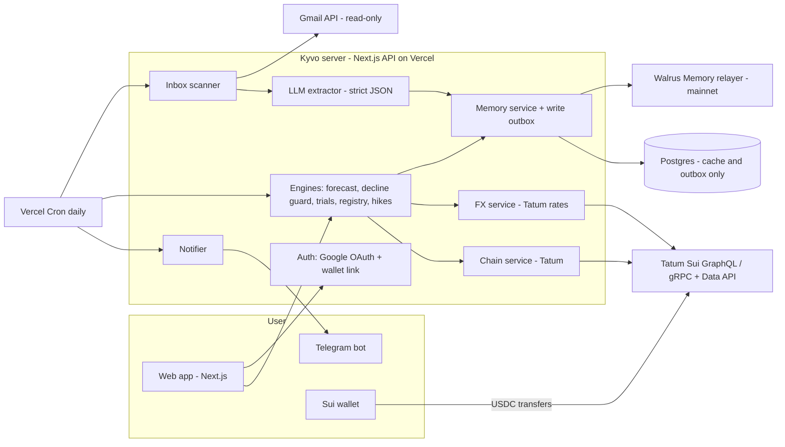

# Kyvo: Architecture

> Never get declined again. Kyvo watches every dollar subscription, trial and saved card from your inbox, learns how each one really bills, and tells you exactly what to fund, in your own currency, before the charge hits. Your dollars live as USDC on Sui. Everything Kyvo learns lives in Walrus Memory.

**Hackathon:** Total Recall (Walrus x Tatum). Deadline Nov 10, 2026, 17:00 UTC.
**Track:** 03 Consumer Finance Apps. Organizer idea: "Subscription managers with learned spend limits".
**Bonus targets:** Best Walrus Memory ($500), Best Tatum AI Builder app ($500).
**Scope:** global. Any user paying dollar subscriptions from a non-dollar currency on a pre-funded card. The demo story is Nigeria.

---

## 1. Problem

People outside the US pay for Netflix, Spotify, ChatGPT, Canva, AWS and similar in dollars, usually through pre-funded virtual dollar cards. Four things go wrong:

1. **Declines are punished.** Most providers charge for declines caused by insufficient funds: Chipper ₦250, Eversend $0.40, Raenest $0.40, walllet $0.50. Some terminate the card after repeated declines: Eversend after 3 in a row, or after the first payment on a new card fails. Grey charges no fee but deletes the card after 3 failed charges from the same platform.
2. **Amounts drift.** Prices rise, exchange rates move, and per-transaction card fees ($0.50 to $0.90) are easy to forget.
3. **Trials convert silently.**
4. **Cards stay on file.** Usage-billed services (AWS, OpenAI API, Vercel, Twilio) can force-charge a saved card even when it's frozen. A negative balance can then disable the card.

## 2. What Kyvo does

| Feature | What the user sees | What memory does |
|---|---|---|
| **Inbox auto-scan** | Connect Gmail once; subscriptions appear on their own | Every extracted charge becomes a memory |
| **Funding forecast** | "Fund $61.40 by Fri (≈ ₦X)" | Learns real charge days, amounts, hikes and card fees, so forecasts improve monthly |
| **Decline guard** | A Telegram warning 48 hours before an uncovered charge | Remembers past declines per card and applies that provider's rules |
| **Trial tracker** | "Adobe converts to $22.99 in 3 days" | Remembers why you started it and your habit of letting trials convert |
| **Card-on-file registry** | "6 services hold Card A; 2 unused since August" | Builds, over months, the list of who holds each card |
| **Usage-billed watch** | "AWS usually bills on the 2nd; last bill $3.40" | Learns usage-billed merchants and their typical bills |
| **Promise keeper** | "You said you'd cancel Canva 6 weeks ago" | Stores your stated intentions |
| **Price-hike detector** | "Netflix rose $15.49 to $17.99" | Compares each charge to that merchant's history |
| **FX timing** | "Your rate moved 3.1% this week" | Remembers the rate you usually fund at |
| **Dollar vault (Sui)** | USDC balance and months of runway | Remembers your monthly burn |
| **Family-plan split** | "Tunde owes $4.50 for Netflix; paid 2 days late last time" | Remembers who pays, and how late, per member |
| **Dollar Wrapped** | A monthly shareable report | Its headline number is forecast accuracy over time |
| **Total Recall button** | Wipe the cache and rebuild everything from Walrus | Proves Walrus is the source of truth |

## 3. System overview



**Rules:**
- **Walrus Memory is the source of truth for everything learned.** Postgres is a rebuildable cache plus the write outbox. The "Total Recall" button proves it.
- **All Walrus and Tatum calls are server-side.** The relayer does not return the `Access-Control-Allow-Origin` header, so browsers can't call it. Keys never reach the browser.
- **The design is multi-tenant.** One operator Walrus Memory account, one delegate key on the server, and one namespace set per user. This is the pattern Walrus documents for multi-tenant apps.

## 4. Tech stack

| Layer | Choice | Why |
|---|---|---|
| App | Next.js (App Router) + TypeScript + Tailwind | One deploy holds the UI, API and cron |
| UI start | **Tatum AI Builder** (ai.tatum.io) generates the dashboard shell. It exports Vite and Express, so the UI is ported to Next.js; tag `ai-builder-v0` marks the untouched export commit | AI Builder bonus |
| Hosting | Vercel | Free tier, cron included |
| Cache DB | Neon Postgres + Drizzle ORM | Serverless-friendly |
| Memory | `@mysten-incubation/memwal` (pin the version; ≥ 0.1.11) | Mainnet relayer |
| Chain reads | Tatum Sui **GraphQL** `https://sui-mainnet.gateway.tatum.io/graphql`, header `x-api-key` | Other entrants report JSON-RPC as retired; GraphQL gives filtered history |
| Chain fallback | Tatum Sui gRPC `https://sui-mainnet-grpc.gateway.tatum.io`, **native** transport (`@protobuf-ts/grpc-transport`) | gRPC-web gets rejected by the gateway |
| FX | Tatum Data API `GET /v4/data/rate/symbol` and OHLCV | Supports NGN, GHS, KES, EGP and other fiats |
| Wallet | `@mysten/dapp-kit-react` (`@mysten/dapp-kit` is deprecated: JSON-RPC only), plus pasting an address | Read the vault address. Kyvo never signs or moves money |
| Inbox | Gmail API, `gmail.readonly` scope (Outlook via Microsoft Graph `Mail.Read` is a stretch) | Automatic data |
| LLM | Vercel AI SDK + Groq free plan (`openai/gpt-oss-20b`), with `generateText`, `Output.object` and Zod | Strict JSON extraction at no cost; no default retention of inference data |
| Notifications | Telegram Bot API via `grammy` (webhook) | Free; instant reminders |
| Tests | Vitest + `MemWalMock` | `MemWalMock` lacks `listMemories`, so test the rebuild path against the real relayer |

**Node version:** 22.23.4 or newer (also accepted: 24.22.1+, 26.12.1+).

## 5. Data flow

### 5.1 Onboarding
1. The user signs in with Google. Kyvo asks for `openid email` plus `gmail.readonly`.
2. The user picks a home currency (NGN default) and card provider(s) from the rules table.
3. Optionally, the user connects a Sui wallet as their dollar vault.
4. Optionally, the user links Telegram with `/start <code>`.
5. **Backfill:** scan the last 12 months of mail. Write extracted events to the outbox, then to Walrus. Each scan call handles one batch, saves a cursor and returns. The onboarding page keeps calling until the scan is done and shows "syncing to Walrus" while the outbox drains (§5.3).

### 5.2 Inbox scan (daily cron, plus a manual "scan now" button)
- **Gmail query:** billing mail only. Example: `newer_than:1d (subject:(receipt OR invoice OR "payment" OR "trial" OR "renew" OR "price" OR "declined" OR "card") OR from:(netflix.com OR openai.com OR spotify.com OR aws OR vercel.com OR ...))`.
- **Dedupe:** a SHA-256 hash of the Gmail message ID, stored in Postgres. The raw email body is never stored or logged.
- **Extraction:** the LLM returns one typed event per email, validated by Zod. Discard the event if the model's confidence is below 0.6. Bills in the user's home currency are also discarded before they reach permanent memory: Kyvo tracks foreign-currency bills, and real scans showed wallet alerts (OPay and similar) otherwise reading as subscriptions. Groq's strict mode needs every field in `required` and `additionalProperties: false`, so optional fields in the extraction schema are nullable rather than omitted. Trim each email to its billing text before sending it, and let the resumable scan (§5.1) pause when the daily token limit is reached.
- **Forwarding fallback:** first in the cut order, and built only if Gmail OAuth fails. How inbound mail would arrive isn't designed yet. It would reuse the same extractor.

```ts
type ExtractedEvent =
  | { kind: "charge"; merchant: string; amount: number; currency: string; date: string; cardHint?: string }
  | { kind: "trial_start"; merchant: string; endsAt?: string; convertsTo?: number; currency?: string }
  | { kind: "decline"; merchant: string; amount?: number; date: string; cardHint?: string; reason?: string }
  | { kind: "price_change"; merchant: string; from?: number; to: number; effective?: string }
  | { kind: "card_added"; merchant: string; date: string; cardHint?: string }   // $0 or $1 authorization
  | { kind: "usage_bill"; merchant: string; amount: number; period?: string; date: string }
  | { kind: "refund"; merchant: string; amount: number; date: string; cardHint?: string }  // forecasts must not count refunded charges
  | { kind: "card_topup"; provider: string; amount: number; currency: string; date: string };
```

### 5.3 Memory write path (outbox)
1. Each event becomes a memory envelope (§6) and is inserted into the Postgres `outbox` table.
2. A drainer (on each request and on cron) sends batches with `rememberBulk` (at most 20 items per call), paced to at most 20 memories per minute. The real per-account cap observed is about 24 `remember()` calls per minute.
3. The drainer stores the `job_id`, then polls with `getRememberStatus`, and stores the `blob_id` once the status is `done`.
4. **Idempotency:** `idempotency_key = sha256(userId + eventType + merchant + date + amount)` is unique in the outbox, so an event is only queued once. `rememberBulk` takes one key per batch, not per item, and has no `dedupe` option, so each batch's key is derived from its members. A batch with no acknowledgement is resent unchanged with the same key.
5. **Retries:** on 429 or 503, back off using `retry_after`. Never re-send after a client timeout without checking first, because the write may have landed anyway.
6. **One drainer at a time:** the write cap is per account, and all users share one operator account. A Postgres lock stops concurrent requests from exceeding it. Each drain call sends one batch and returns, so it can't outrun serverless time limits.

### 5.4 Recall and rebuild
- **Normal reads** come from the Postgres cache.
- **The rebuild** ("Total Recall" button, or a fresh deploy) runs `listNamespaces()`, keeps the namespaces that start with `ky:<userHash>:`, recalls each, decodes the envelopes, and recomputes state. If a namespace returns exactly the recall cap, or fewer records than `listMemories` counts for it, the rebuild reports an error instead of silently dropping records.
- **Getting the newest record:** use `recall({ sort: "recent" })`. The default ranking is by relevance only and does not guarantee the newest record is returned.
- **Explanations:** recall by meaning, e.g. "why do you expect Netflix to cost $17.99?". The UI's "Why?" panel shows the cited blob IDs.

## 6. Walrus Memory design

### 6.1 Namespaces (each stays far under the 100-result recall cap)
`userHash = sha256(googleSub + SALT).slice(0, 16)`. No personal data appears in namespace names.

| Namespace | Holds |
|---|---|
| `ky:<u>:profile` | Home currency, card providers, preferences, stated rules |
| `ky:<u>:m:<merchantSlug>` | Charges, declines, price changes, usage bills, card-added and card-removed events for one merchant |
| `ky:<u>:trials` | Trial starts, conversions, the user's reasons |
| `ky:<u>:cards` | Card registry: card labels and provider, entered balances, top-ups. Who holds each card is derived from merchant events |
| `ky:<u>:promises` | "I'll cancel X", "Don't let AWS charge again" |
| `ky:<u>:forecasts:<month>` | Each forecast, then its actual and its error. One namespace per month, so they can't pile up past the recall cap |
| `ky:<u>:family` | Shared plans and members |
| `ky:<u>:family:<year>` | Verified payments and lateness, by year so they can't pile up past the recall cap |

### 6.2 Envelope (one memory = one fact)
```
<human sentence> #ky {"v":1,"t":"charge","m":"netflix","amt":17.99,"cur":"USD","d":"2026-11-03","card":"grey-1","src":"gmail","h":"<sha256>"}
```
- **The sentence** is what semantic recall matches on, and what the "Why?" panel shows.
- **The JSON after `#ky`** is what rebuilds state exactly. A line that fails to parse is ignored.
- **Superseding:** memory is append-only. Facts that change (a price, a promise, a card removed) are new events, and current state is always derived from the newest event.
- **Forecast source:** `forecast` and `forecast_result` events carry `"src":"hindcast"` or `"src":"live"` (§6.3).

### 6.3 The learning loop (Best Walrus Memory pitch)
1. **Forecast:** at month start, write `forecast` events (expected date, amount and fee per merchant).
2. **Actual:** when the charge email arrives, write `charge`.
3. **Score:** write `forecast_result` with the error in dollars and days.
4. **Adjust:** the next forecast uses the corrected interval, amount, hike detection and card fee.
5. **Show it:** a chart of forecast error per month (demo centerpiece), plus a toggle to "Ignore memory" that shows what a memory-less forecast would say.

**Hindcast and live data:** the hackathon lasts 6 days, too short for months of live forecasts. So Kyvo replays email history in date order, forecasting each month only from earlier charges, and marks those events `hindcast`. New forecasts are marked `live`. The chart, demo and blog always label which is which.

## 7. Engines

### 7.1 Forecast
- **Next charge date:** median interval between past charges (fallback: 30 days), anchored to the last charge.
- **Amount:** the last charge, adjusted by any `price_change`. For usage-billed merchants, the median of the last 3 bills.
- **Card fee:** add the provider's per-transaction fee from the rules table (§7.3).
- **Funding needed:** total charges in the next 30 days + fees + a buffer (5%, at least $1) − the known card balance, due two days before the first charge. A merchant more than 10 days overdue, or whose only recent bill was refunded, is treated as stopped. The card balance comes from top-up emails or is entered by the user; card providers expose no API.
- **Local currency:** `fundLocal = fundUSD × rate(USDC→homeCurrency) × (1 + providerMarkup)`, with the rate from Tatum. Tatum's rate isn't what card providers charge, so local amounts always show as "≈" and each provider has a funding markup in the rules table. The default is set by comparing a real top-up with Tatum's rate.

- **Comparing with no memory:** the "Ignore memory" forecast assumes the first price ever seen repeats monthly, forever: no fees, no refunds, nothing cancelled. Both forecasts are scored the same way. A first-ever bill counts as a miss for both.

### 7.2 Decline guard
- Runs daily. For each charge due within 48 hours, it compares against the expected card balance.
- It applies the provider's rules. For example, on Eversend: "2 declines so far; 1 more terminates the card."
- It sends a Telegram alert with the exact amount to fund in local currency.

### 7.3 Provider rules table (`config/providers.ts`; adding a provider is data, not code)
| Provider | Decline fee | Per-payment fee | Rule on repeated declines |
|---|---|---|---|
| Chipper (NG) | ₦250 | $0.90 | Can revoke a card after repeated declines (no number published) |
| Eversend | $0.40 (some of its pages say $0.35) | Not confirmed | 3 in a row, or the first payment on a new card. A success resets the count |
| Grey | Not confirmed | None | 2 failed payments can get a card flagged or frozen |
| Raenest | Not confirmed | $0.50 | Not confirmed |
| Cleva (Standard USD) | $0.50 | Not confirmed | Can end a card after repeated declines (no number published) |
| walllet | Not confirmed | Not confirmed | Not confirmed |
| Bybit | Not confirmed | Not confirmed | Not confirmed |
| Zenith Bank | Not confirmed | Not confirmed | Not confirmed |
| Other bank card | Not confirmed | Not confirmed | Not confirmed |

Re-verified on Nov 5, 2026, which corrected several numbers in the first draft of this table. **"Not confirmed" means Kyvo states nothing and adds no fee, rather than guessing.** Sources are in `config/providers.ts` and the README, and the app links them. Re-check before the demo, because providers change their terms.

### 7.4 Trials, registry, hikes, promises
- **Trials:** reminders 3 days and 1 day before conversion. If no end date is found, ask the user to confirm it.
- **Registry:** `card_added` and the first `charge` per merchant mark a card as on file. `card_removed` comes from the user. "Stale" means no charge and no mention for 60 days.
- **Usage-billed detection:** amounts vary by more than 20% between months, or the merchant is on the known list.
- **Hikes:** a fixed-price bill rises by more than 2% → a `price_change` memory plus an alert. Usage bills and one-off purchases aren't hikes. A rise that's only tax isn't a price rise: real Claude Pro receipts went from $20.00 to $21.50 because 7.5% Nigerian VAT was added, so read subtotal and tax when the email shows them.
- **Trial end dates:** some emails state only a length ("for 30 days"). Compute the end from the start date rather than asking the user.
- **Promises:** natural language in the app or bot ("cancel Canva") becomes a `promise`. It's re-surfaced weekly until resolved.

### 7.5 Family-plan split (the Sui transaction role)
1. The owner creates a plan: merchant, members, each member's share, and each member's Sui address.
2. Members pay the owner's vault address in USDC on Sui.
3. **Verification:** a Tatum GraphQL query of transactions affecting the vault address returns balance changes. Kyvo matches sender + USDC amount within ±1% + time window, then marks the member paid.
4. Each payment is remembered with lateness in days. The next reminder's tone is based on that history.

USDC coin type on Sui mainnet: `0xdba34672e30cb065b1f93e3ab55318768fd6fef66c15942c9f7cb846e2f900e7::usdc::USDC` (verify on Day 1).

## 8. Tatum integration (the 30% technical score names Sui RPC explicitly)

| Use | Interface | Detail |
|---|---|---|
| Vault USDC balance | Sui GraphQL | `address(address:$a){ balance(coinType:$usdc){ totalBalance } }` |
| Incoming family payments | Sui GraphQL | `transactions(last:50, filter:{affectedAddress:$a, afterCheckpoint:$f}) { nodes { digest sender{address} effects{ timestamp status balanceChanges{ nodes{ owner{address} amount coinType{repr} } } } } }`. `afterCheckpoint` is required (§13) |
| Verify one payment | Sui GraphQL / gRPC | Look up by digest; check status, amount and recipient |
| FX now | Data API | `GET https://api.tatum.io/v4/data/rate/symbol?symbol=USDC&basePair=NGN` |
| FX history | Data API | `GET /v4/data/rate/symbol/ohlcv` (needs a `unix` or `time` parameter; other parameters still to be confirmed when this is built), for the "rate moved X% this week" alert |
| Health | `/status` page | Times every Tatum and Walrus call; shown in the demo |

**Client rules:**
- Pace at 3 requests per second (free plan).
- Retry 429s with backoff.
- Count credits; the free plan includes 100K.
- Cache FX for 10 minutes.
- If Tatum returns 402 (out of credits), show "chain data temporarily unavailable". Never fake a result.

## 9. Security and privacy
- **Server-only secrets:** `MEMWAL_KEY`, `TATUM_API_KEY`, Google client secret, Telegram token. Never prefix them with `NEXT_PUBLIC_`.
- **Google refresh tokens** are encrypted at rest (AES-GCM, key in env).
- **Raw emails** are never stored or logged. Only extracted facts are kept.
- **LLM provider:** billing email text is sent to Groq for extraction. Groq says it doesn't retain inference data by default, but may log inputs and outputs for up to 30 days when troubleshooting failures or investigating abuse. Its data page doesn't state a training policy, so don't claim one. Turn on Zero Data Retention in the Groq console, and tell test users about this. Don't use the free Gemini tier: its terms say not to submit personal information and that human reviewers may read content.
- **Namespaces** are derived server-side from the authenticated user. They're never taken from the request.
- **Disclosure:** in the multi-tenant pattern, the operator account owns users' memories, as the Walrus docs state. Say so in the README and blog. Future work: a user-owned account with Kyvo as a revocable delegate.
- **The MEMWAL owner key** never touches the server.
- **Memory content:** blobs on public Walrus are SEAL-encrypted. `scripts/probe-memwal.ts` confirmed it on mainnet by downloading its own blob from a public aggregator (354 bytes, test text not readable). The relayer does handle plaintext to embed and to return recall results, so it's trusted with content. The README must say so.

## 10. Portability (stretch)
A read-only MCP endpoint `/api/mcp` with per-user tokens (`kyvo_upcoming`, `kyvo_why`). Ask Claude or Codex "what's due this week?" and get answers from the same Walrus memory. It's a stretch goal because operator-owned memory can't safely be shared through the raw Walrus MCP.

## 11. Repository layout
```
kyvo/
  app/                    Next.js routes: dashboard, subscriptions, trials, cards, family, wrapped, status, proof
  app/api/                auth, scan, outbox/drain, cron, telegram, chain, fx, rebuild
  components/             app shell, "Why?" panel
  design-tokens/          CSS variables and Tailwind tokens from the AI Builder export
  lib/memory/             client, envelope encode/decode, namespaces, outbox drainer, rebuild
  lib/chain/              tatum-graphql, tatum-grpc (native), usdc
  lib/fx/                 tatum-rates
  lib/inbox/              gmail, query builder, extractor (AI SDK + Zod)
  lib/engines/            forecast, decline-guard, trials, registry, hikes, promises, family
  config/providers.ts     provider rules table
  db/                     drizzle schema: users, tokens, outbox, cache_events, seen_messages, scan_cursors, notifications, drain_state
  scripts/                seed-demo, probe-tatum, probe-memwal, proof
  tests/                  vitest unit tests + live smoke tests
  docs/                   architecture.md, Progress.md, BLOG.md, DEMO.md
```

## 12. Environment variables
```
MEMWAL_KEY=            # delegate private key (hex)
MEMWAL_ACCOUNT_ID=     # account object ID (not a wallet address)
MEMWAL_SERVER_URL=https://relayer.memory.walrus.xyz
MEMWAL_AGENT_ID=       # delegate PUBLIC key (64 hex) for the form
TATUM_API_KEY=
TATUM_SUI_GRAPHQL=https://sui-mainnet.gateway.tatum.io/graphql
TATUM_SUI_GRPC=https://sui-mainnet-grpc.gateway.tatum.io
GOOGLE_CLIENT_ID= / GOOGLE_CLIENT_SECRET=
TOKEN_ENC_KEY=
TELEGRAM_BOT_TOKEN=
LLM_API_KEY=
DATABASE_URL=
NS_SALT=
CRON_SECRET=
```
The Walrus Memory SDK doesn't read environment variables, so pass every value explicitly to `MemWal.create`.

## 13. Known gotchas (from docs and other entrants)
1. Sui JSON-RPC is retired. Use GraphQL, or gRPC with the **native** transport.
2. The relayer doesn't return CORS headers, so all calls go through the server.
3. The real write cap is about 24 `remember()` per minute per account, and extra delegate keys don't raise it. Pace the outbox.
4. Recall can fail or miss records right after a write while the index catches up. Wait for `blob_id`, then recall.
5. The default ranking is by relevance only. Use `sort: "recent"` for the newest record.
6. `forget` only drops index rows, and `restore` re-indexes them. There is no per-memory delete, so use superseding events.
7. The relayer has had multi-hour outages (Oct 30–31). Write the first 10+ memories on Day 1.
8. `accountId` ≠ wallet address. Using the wrong one gives the same 401 error.
9. Gmail testing mode allows 100 test users, and logins expire after about 7 days. Re-connect before recording.
10. Gasless USDC transfers below 0.01 failed for TwiceShy. Use amounts of 0.01 USDC or more.
11. Tatum free plan: 3 requests per second and 100K credits.
12. The Tatum gateway prunes old Sui history. An address or unfiltered `transactions` query with no starting checkpoint now fails with `OutOfRange`, so always pass `afterCheckpoint`. Mainnet runs about 4.2 checkpoints a second, and history reached back to Jan 2026 when checked in Nov 2026.
13. Vercel Hobby runs cron once a day (±59 minutes), allows 300 seconds per function, never retries, and can deliver twice. So every daily step is safe to repeat, and Telegram messages are claimed by key before sending.
14. The relayer accepts at most 20 job IDs per status request.
15. Groq's docs list `openai/gpt-oss-20b` at 30 requests/min, 1K requests/day, 8K tokens/min and 200K tokens/day, but it's unclear whether that table is the free plan. Check console.groq.com/settings/limits. A 12-month backfill may take more than one day of quota.

## 14. Demo (2:30) and blog
- **Demo beats:** the decline notification hook → connect Gmail, and the dashboard fills itself → forecast with local currency → the memory beat (forecast-error chart, plus the "Ignore memory" toggle showing what a blank forecast would say) → registry ("6 services hold your card") and trial alert → Sui proof (vault balance, verified family payment, blob IDs, `/status`) → close.
- **Blog (dev.to plus repo `docs/BLOG.md`):** what it does, how it uses Tatum and Walrus, **how it learned over time** (the chart and real numbers), what went wrong, and limits.
